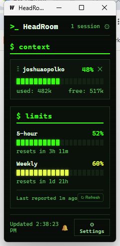
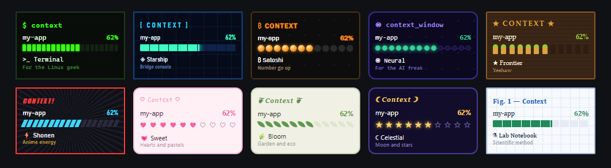

# HeadRoom

A lightweight desktop app that shows how much room you have left in Claude Code: context window usage across all your active sessions, plus your 5-hour and weekly plan limits.

**It replaces the status line for the desktop app.** In the Claude Code terminal, a `/statusline` can show context remaining, 5-hour usage and 7-day usage. The Claude desktop app has no status line, so those numbers aren't available there. HeadRoom puts them in a small always-on-top window, for the desktop app and the terminal alike.

**[Download for Windows](https://github.com/jopolko/headroom/releases/latest)** (a single portable `.exe`, no installer needed)

Forked from [gosparq/claudewatch](https://github.com/gosparq/claudewatch) (MIT). Not affiliated with Anthropic.

<p align="center"></p>

<p align="center"></p>

<p align="center"><sub>Ten themes, each with its own meter, fonts, headings and wording.</sub></p>

## Why?

When working with AI coding assistants on complex tasks, context management becomes critical. Claude Code has a finite context window (200k tokens, or 1M on extended-context models), and when it fills up, Claude automatically compacts the conversation—often losing important details you wanted to preserve.

**HeadRoom** gives you visibility into your context usage across all active sessions, so you can intentionally save your work before Claude does it for you.

When you get the warning, tell Claude:

*Write everything we did so far to progress.md, ensure to note the approach we're taking, the steps we've done so far, and the current failure we're working on.*

### The RPI Framework

This tool pairs well with the **Research-Plan-Implement (RPI) Framework**—a structured methodology for working with Claude Code:

| Phase | Purpose |
|-------|---------|
| **Research** | Deeply understand the codebase before making changes |
| **Plan** | Create detailed, validated implementation plans |
| **Implement** | Execute plans methodically, phase by phase |

Without structure, AI-assisted development often becomes chaotic: context gets lost between sessions, no clear methodology for multi-file changes, and painful handoffs when stopping mid-task.

**Learn more:**
- [Watch the RPI methodology video](https://www.youtube.com/watch?v=rmvDxxNubIg)
- [RPI Framework for Claude Code](https://github.com/acampb/claude-rpi-framework)

## Features

- 🖥️ **Floating window** - Always on top, stays visible while you work
- 📊 **Real-time monitoring** - Updates every 2 seconds
- 🌍 **Cross-platform** - Works on macOS, Windows, and Linux
- 🚀 **Lightweight** - ~10MB binary, minimal resource usage
- 📁 **Multi-project** - Monitors all active Claude Code sessions automatically
- 🏷️ **Project names** - Labels sessions by the project folder under `~/projects` they're working in, with the session title underneath
- ✕ **Dismiss** - Hide a session until it has new activity
- 📈 **Limits** - 5-hour and weekly usage with reset countdowns, for Pro/Max plans (see [Limits](#limits-where-the-numbers-come-from))
- ↕️ **Your order** - Drag the ⋮⋮ grip on a row to reorder; the order stays put
- 🎨 **Themes** - Ten full styles (Linux terminal, sci-fi, Bitcoin, AI, cowboy, anime, kawaii, garden, celestial, lab notebook) each with its own meter, fonts, headings and wording, three plain themes, an accent color picker, and a font and size selector
- 🧭 **Setup wizard** - A first-run walkthrough, and a gear icon for changing anything afterwards

Works with the Claude Code terminal and the Claude desktop app (Code tab); both write the same session logs.

## Installation

> **Note**: The original app was only tested on macOS. The limits, labels, dismiss, reordering and settings features were developed and tested on Windows 11 against the Claude desktop app and the terminal CLI; they are untested on macOS and Linux. Linux requires building from source on a Linux machine—contributions welcome!

### Pre-built Binaries

Download the latest Windows build from the [Releases page](https://github.com/jopolko/headroom/releases/latest): unzip it and run `HeadRoom.exe`. Binaries are published as release downloads, not stored in the repository.

### Build from Source

**Prerequisites:**
- [Go 1.21+](https://go.dev/dl/)
- [Wails CLI](https://wails.io/docs/gettingstarted/installation): `go install github.com/wailsapp/wails/v2/cmd/wails@latest`
- **macOS**: Xcode command line tools (`xcode-select --install`)
- **Windows**: WebView2 (usually pre-installed on Windows 10/11)
- **Linux**: `sudo apt install libgtk-3-dev libwebkit2gtk-4.0-dev`

```bash
# Clone or download this project
cd headroom

# Development mode (hot reload)
make dev

# Build for your current platform
make build

# Build for all platforms
make build-all
```

### Install (macOS)

```bash
make install-mac
# App will be available in /Applications
```

## Usage

1. **Launch the app** - Double-click `HeadRoom.app` (macOS) or `HeadRoom.exe` (Windows). The first launch opens a short setup wizard; HeadRoom is a single executable and needs nothing installed beyond what Windows already has (the WebView2 runtime that Windows 10/11 ship). On Windows, add a Start Menu shortcut and pin it to the taskbar for one-click launch.
2. **Window auto-positions** - Opens in the top-right corner, always on top (drag to reposition).
3. **Work normally** - Open projects in Claude Code, in the terminal or the Claude desktop app. Each active session shows up as a row on its own; there is nothing to register.
4. **Watch the colors** - Each bar changes color as it fills (green, yellow, orange, red, and pulsing red near the top), so you can see at a glance when a session is filling up and save your work before Claude compacts it.

### How projects show up

HeadRoom doesn't need to be pointed at your project folders. Claude Code (terminal and desktop app) records every session in `~/.claude/projects/`, and HeadRoom lists every session it has seen active. Open a project in Claude and its row appears within a couple of seconds.

**Idle sessions keep their last reading.** After `activeMinutes` (default 60) without activity, a session's row stays, dimmed and marked `idle 2h 10m`, showing the last known context. Nothing is polled for an idle session (its log isn't changing, so there is nothing to read), and the row goes back to normal the moment you resume that session. It stays until you remove it with the ✕, even across restarts.

**Row names.** Each row is labelled with the project folder the session is working in, with the session's title underneath. The project is the first folder under a directory named `projects` in the session's working directory (`C:\Users\me\projects\my-app\src` gives `my-app`), and it follows the session if it moves between projects. If the working directory isn't under a `projects` folder, the row uses that folder's own name.

**Showing only some projects.** By default every active session is listed. To limit it, open Settings (the gear at the top right) and choose "Only these projects", or set `projects` in `~/.headroom.json`. Names are matched against the row names above, ignoring case.

**Order.** Rows stay where you put them. Drag the ⋮⋮ grip on a row to move it up or down; the order is remembered. A new session is added at the bottom.

**Hiding a session.** Click the **✕** on a row to remove it. It stays gone until that session has new activity, then comes back on its own, so reopening a project in Claude and working in it brings its row back. A brand-new session in the same project always appears as a new row.

Several rows with the same project name are separate sessions (each conversation is its own log); the title under the name tells them apart.

### What it monitors

The app scans `~/.claude/projects/` for active sessions and takes the last assistant message's input and cache tokens as the current context size, shown as a percentage of the context window. It reads local files only.

**Why it may differ from Claude's own meter.** The count is the same one Claude Code's status line uses: input plus cache tokens of the latest response, not counting that response's output. HeadRoom reads the log every 2 seconds, and in a long turn every tool call writes a new entry, so it can run ahead of the desktop app's context display, which appears to update less often. In one check the app was about four minutes behind, and the two also differed by about 1% for reasons I couldn't determine. Compare right after a turn finishes and they should agree within a percent or two.

## Settings

Open Settings from the gear at the top right any time. **Look** has ten styles and three plain themes. A style is a whole personality, not a palette: its own meter, fonts, background pattern, heading decoration, logo and wording, and the picker shows each one as a live miniature.

| Style | Meter | Flavor |
|-------|-------|--------|
| **Terminal** (Linux) | Segmented LED blocks | `$ context`, lowercase `used`/`free`, scanlines, monospace |
| **Starship** (sci-fi) | Glowing gauge with tick marks | `[ CONTEXT ]`, cut corners, grid |
| **Satoshi** (Bitcoin) | Minted coins | `₿` headings, `Spent`/`Left`, orange on black |
| **Neural** (AI) | Chain of nodes on a wire | `context_window`, `rate_limits`, monospace |
| **Frontier** (cowboy) | A belt of cartridges | `★ CONTEXT ★`, slab serif, wood grain |
| **Shonen** (anime) | Slanted power gauge | `CONTEXT!`, impact lettering, speed lines, `Power used`/`Power left` |
| **Sweet** (kawaii) | Hearts | `♡ Context ♡`, handwriting headings, pastel pink, hearts and sparkles |
| **Bloom** (garden and eco) | Leaves | `❦ Context ❦`, italic serif, sage and cream |
| **Celestial** | Stars | `☾ Context ☽`, starfield, gold on indigo |
| **Lab Notebook** (scientific) | Ruled gauge | `Fig. 1 — Context`, graph paper, serif |

The plain themes are Midnight, Daylight and High contrast. They are original designs and don't use any brand's characters or logos.

You can override the accent color and the font (the fonts are the ones that ship with Windows, so nothing is bundled) and set the text size. **Projects**, **Context window** and **Limits** are covered below. Changes save as you make them, and "Run setup again" replays the wizard.

Settings are stored in `~/.headroom.json`, which you never need to edit by hand but can. It is re-read on every refresh, so edits apply immediately:

```json
{
  "projects": ["my-app", "my-api"],
  "activeMinutes": 30,
  "contextTokens": 1000000,
  "pollLimits": false,
  "pollMinutes": 10,
  "theme": "midnight",
  "accent": "",
  "font": "system",
  "fontSize": 13,
  "setupDone": true,
  "fixedSize": false
}
```

| Key | Default | Meaning |
|-----|---------|---------|
| `projects` | all | Only show sessions in these project folders (the first folder under a `projects` directory in the session's working directory) |
| `activeMinutes` | 60 | How long a session can go without activity before its row is marked idle (it stays listed) |
| `contextTokens` | 200000 | Context window to measure against, for sessions that haven't exported their own size (use 1000000 for 1M-context models) |
| `pollLimits` | false | Opt in to background limit refreshes, see [headless polling](#limits-option-b-headless-polling-opt-in) |
| `pollMinutes` | 10 | Minutes between automatic polls (minimum 5; halved above 85% usage) |
| `theme`, `accent`, `font`, `fontSize` | midnight, theme's, theme's, 13 | Appearance: a theme id: `linux`, `scifi`, `bitcoin`, `ai`, `cowboy`, `anime`, `sweet`, `bloom`, `celestial`, `lab`, `midnight`, `light` or `contrast`; `accent` is an optional `#rrggbb`; `font` empty or `theme` uses the theme's own |
| `setupDone` | false | Set once the wizard has been completed |
| `fixedSize` | false | By default the window fits its height to what it is showing; set true to keep your own size |

## Limits: where the numbers come from

HeadRoom can use two sources for the limits. You only need one. Context bars need none of this; they read local session logs and cost nothing.

| Source | Shows | Authentication | Cost |
|--------|-------|----------------|------|
| **Status line export** | 5-hour and weekly plan limits, plus each session's real context window size | None. Claude Code runs your status line script and hands it the data. | Free. No extra requests. |
| **Headless polling** (opt-in) | 5-hour and weekly plan limits | Your own `claude` login, used by the official CLI on your machine. HeadRoom never reads or stores it. | A small real request per poll: it slowly draws on your plan, or bills your API key. See [What polling costs](#what-polling-costs). |

### Limits, option A: status line export

Claude Code only reports your 5-hour and weekly plan usage (Pro/Max plans) to its **status line command**. Have yours save the JSON it receives:

- Copy `scripts/headroom-statusline.py` somewhere and set it as your status line in `~/.claude/settings.json`:
  ```json
  "statusLine": { "type": "command", "command": "python /path/to/headroom-statusline.py" }
  ```
- Or, if you already have a status line script, copy the `export_for_headroom` function from that file into it and call it with the parsed JSON.

The script writes `~/.headroom/status-<session_id>.json`.

**Limitations:** the Claude desktop app doesn't run the status line, so only terminal sessions export. And the limit numbers inside the file only change after a response, so they can lag behind the real values. "Last reported X ago" shows how old the reading is.

### Limits, option B: headless polling (opt-in)

Turn on "Check my 5-hour and weekly limits automatically" in the setup wizard or settings (`"pollLimits": true`). While one of your sessions has been active in the last 30 minutes, HeadRoom runs one headless Claude Code call:

```
claude -p "reply with: ok" --model haiku --output-format stream-json --verbose --no-session-persistence
```

Claude Code emits a `rate_limit_event` with both windows, which HeadRoom reads.

#### What polling costs

Polling is a slow drip, not a one-off. Each poll is a real Haiku request: Claude Code sends its normal system prompt and tool definitions even for a one-word reply, so one poll is about 40,000 input tokens (mostly cache reads) and a handful of output tokens. At the default of one poll every 10 minutes while you're working, that's about 6 polls and 240,000 mostly cached tokens an hour. HeadRoom never charges anything itself; what you pay depends on what the `claude` command is signed in to:

| `claude` is signed in with | What a poll costs |
|----------------------------|-------------------|
| **A Pro or Max subscription** | No money. Each poll takes a small slice of your 5-hour and weekly limits, so HeadRoom's own checking slowly uses some of the quota it is showing you. I couldn't measure the share, because the usage figure only moves in whole percents; expect it to be small, but it is not zero. |
| **An Anthropic API key** (an `ANTHROPIC_API_KEY` set, or a Console login) | Real money: roughly $0.002 per poll at API list prices, about 1.3 cents an hour at the default. The key's credit balance goes down a little while you work. |
| **A subscription with extra usage switched on** | Free until the 5-hour limit is used up. At 100%, a poll goes through and is billed to extra usage. HeadRoom stops polling once it sees a limit at 100% and starts again after the reset, but it can only react after it has seen the 100%. |

HeadRoom can't tell which of these applies to you. To keep the drip small, it only polls while one of your sessions has been active in the last 30 minutes, and you can lower the frequency or turn polling off in Settings. The status line export (option A, above) costs nothing, at the price of only updating from terminal sessions.

- It uses the official `claude` CLI under your own login, on your machine. HeadRoom never reads or stores your credentials.
- It never runs while you're idle, so it won't start a new 5-hour window by itself.
- It leaves no session log (`--no-session-persistence`) and runs from a temp folder, so it doesn't appear as a session.
- When several sources report, HeadRoom shows the latest window and the highest percentage, since a status line file can hold numbers from before its last refresh.

It's off by default because it spends a little of your plan. Review [Anthropic's terms](https://www.anthropic.com/legal) and decide for yourself; this project is not affiliated with Anthropic and can't speak for their policies. HeadRoom deliberately does **not** call undocumented usage endpoints with your OAuth token.

**How often should it refresh?** Context changes by the second and is free, so it updates every 2 seconds. Plan limits change slowly: a 5-hour window moves roughly 1% every 3 minutes at full burn, so frequent polling buys little.

- **Default: every 10 minutes while you're active** (about 6 probes an hour, roughly 240k mostly cached tokens, about a cent an hour at API list prices). That's fresh enough to plan a compact or a break.
- **Faster when it matters:** above 85% on any limit it polls twice as often, down to a floor of 5 minutes, since that's when a fresher number changes what you do.
- **Exact when you need it:** the **Refresh** button checks right now. Use it before a big decision rather than polling harder all day.
- **Tune it:** `pollMinutes` in the config (default 10, minimum 5). Set `pollLimits` to false to turn polling off entirely.

## Project Structure

```
headroom/
├── main.go           # Wails entry point
├── app.go            # App bindings and the limits poller
├── monitor.go        # JSONL parsing logic
├── config.go         # ~/.headroom.json
├── limits.go         # Plan limits from status line exports
├── poll.go           # Opt-in headless limit refresh
├── order.go          # Remembers the order rows are dragged into
├── dismiss.go        # Per-session dismiss
├── scripts/          # Status line script that feeds HeadRoom
├── frontend/
│   ├── index.html    # UI structure
│   ├── style.css     # Styling
│   └── main.js       # Update logic
├── wails.json        # Wails config
├── go.mod            # Go dependencies
└── Makefile          # Build commands
```

## Development

```bash
# Run with hot reload
make dev

# The app will open and refresh when you edit files
```

## Troubleshooting

### "No active Claude sessions"
- A session only appears once HeadRoom has seen it active (a change in its log while HeadRoom is running, or within `activeMinutes` of launching it)
- If you set `projects` in `~/.headroom.json`, only those project names are shown
- A session you hid with ✕ stays hidden until it has new activity (reset by deleting `~/.headroom/dismissed.json`)
- Check that Claude Code is storing sessions in `~/.claude/projects/`

### Build errors
- Run `wails doctor` to diagnose missing dependencies
- Ensure Go and Wails are in your PATH

## License

MIT License - Feel free to modify and distribute.

## Contributing

Pull requests welcome! Ideas for future features:
- [ ] System tray mode
- [ ] Export context summary
- [ ] MCP server integration
